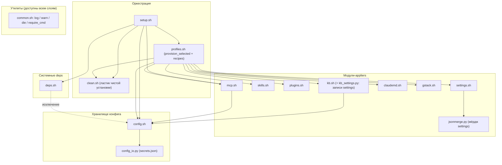
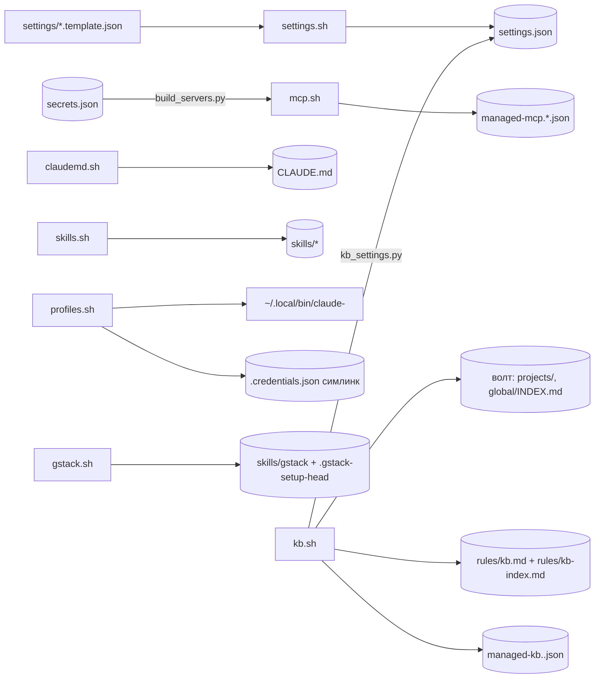
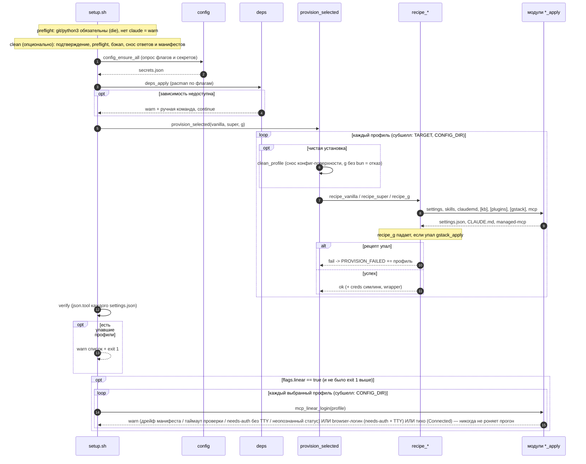

# Архитектура claudefiles

Тех-диаграммы деплоя: структура модулей, потоки данных, прогон `setup.sh`, разница профилей. Правятся в том же PR, что и код. Лейблы однострочные ради рендера в Linear.

## Компоненты по слоям

Слои по ответственности, стрелки вниз. `common.sh`, утилиты, доступны всем слоям (не рисуем 8 стрелок). Единственное обратное ребро-исключение помечено пунктиром: `_chromium_present`→`config` (deps.sh:58).

`setup --> mcp` — единственный appliers-модуль, вызываемый оркестратором в обход `prof`: фаза `linear auth` зовёт `mcp_linear_login` напрямую (`setup.sh`, после verify), а не через рецепт профиля. Отсюда же `mcp --> config`: `mcp_linear_login` читает `config_flag` и `_has_tty` (mcp.sh:41,66).

## Потоки данных

Что откуда читается и куда пишется при деплое. Цилиндры - персистентные стора.

`kb --> setjson` идёт мимо `settings.sh` намеренно: `jsonmerge.py` заменяет управляемый ключ целиком, а под `env` и `permissions` живут записи пользователя, поэтому kb владеет своими записями через манифест, как `mcp.sh` владеет серверами.

## Прогон setup.sh

Один деплой сверху вниз. По фичам deps не фатальны (warn и продолжает). Отсутствие `claude` на preflight тоже только warn, но провижн затем упадёт: `mcp_apply` зовёт `claude` CLI без guard (mcp.sh:23), профиль уходит в fail. Фатально также: нет `git`/`python3` (`require_cmd`), нет обязательного конфига без TTY (config.sh:30); exit 1 при упавших профилях (setup.sh:95-96). После verify и этого exit 1 — отдельная фаза `linear auth` (только при `flags.linear=true`): `mcp_linear_login` за раз на каждый выбранный профиль, в его собственном `CLAUDE_CONFIG_DIR`; она никогда не роняет прогон, только warn.

## Рецепты: vanilla vs super vs g

Ключевые отличия: vanilla не зовёт `plugins_apply` и self-verify, передаёт `_mcp_legacy` для consume, personal-блок `CLAUDE.md` включён (у super - выключен). g тоже не зовёт `plugins_apply` и self-verify, но вместо них зовёт `gstack_apply` и пишет vision-блок в роли producer; personal-блок у g включён, как у vanilla.

```mermaid
flowchart LR
  subgraph V["recipe_vanilla (~/.claude)"]
    direction TB
    v1["settings_apply (vanilla tmpl, dotnet=f, codex=f)"]
    v2["skills_apply (f, f)"]
    v3["claudemd_apply false"]
    v4["claudemd_personal_apply true"]
    v5["kb_apply vanilla (по флагу)"]
    v6["mcp_apply (+ legacy consume)"]
    v1 --> v2 --> v3 --> v4 --> v5 --> v6
  end
  subgraph S["recipe_super (~/.claude-super)"]
    direction TB
    s1["settings_apply (super tmpl, dotnet, cpe)"]
    s2["skills_apply (dotnet, cr)"]
    s3["claudemd_apply cr"]
    s4["claudemd_personal_apply false"]
    s45["kb_apply super (по флагу)"]
    s5["plugins_apply (dotnet, cpe)"]
    s6["mcp_apply"]
    s7["self-verify superpowers, только если claude на PATH -> fail if missing"]
    s1 --> s2 --> s3 --> s4 --> s45 --> s5 --> s6 --> s7
  end
  subgraph G["recipe_g (~/.claude-g)"]
    direction TB
    g1["settings_apply (g tmpl)"]
    g2["skills_apply (f, f)"]
    g3["claudemd_apply false"]
    g4["claudemd_personal_apply true"]
    g5["claudemd_vision_apply producer"]
    g55["kb_apply g (по флагу)"]
    g6["gstack_apply"]
    g7["mcp_apply"]
    g1 --> g2 --> g3 --> g4 --> g5 --> g55 --> g6 --> g7
  end
```

## Слои коротко

- Оркестрация (`setup.sh`, `profiles.sh`) знает фазы и рецепты; провижн каждого профиля идёт в субшелле с экспортом `CLAUDEFILES_TARGET` и `CLAUDE_CONFIG_DIR` (profiles.sh:92).
- Модули-appliers идемпотентны и владеют своим артефактом; `jsonmerge.py`: только логика мёрджа settings, `config_io.py`: только хранилище секретов.
- Все стора секретов пишутся с `chmod 600` (`config_io.py:42-44`, `mcp.sh:26`).
