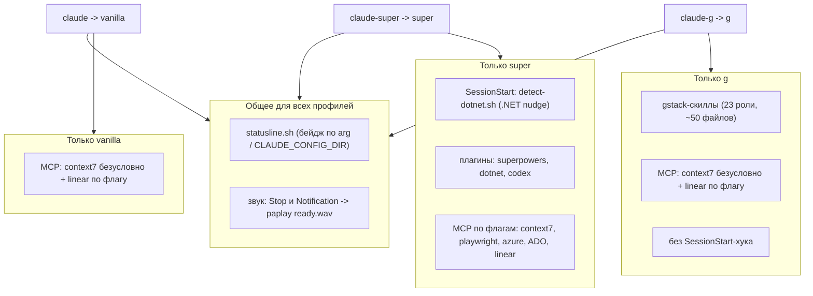

# Runtime claudefiles

Что работает в живой сессии `claude`/`claude-super`/`claude-g`. Явно разделено общее и профиль-only: ваниль не такая пустая, как кажется (звук хода есть у всех трёх).

- **statusline** (statusline.sh): бейдж профиля из аргумента настроек или из `CLAUDE_CONFIG_DIR`; cyan=vanilla, magenta=super, green=g, yellow=прочее.
- **звук** (все три шаблона, `paplay` на Stop и Notification; vanilla:11 / super:25 / g:13): `ready.wav`.
- **SessionStart** (только super): `detect-dotnet.sh` ищет .NET в дереве и подсказывает `dotnet-router`; у g этого хука нет.
- **MCP**: vanilla и g всегда получают context7 и, по флагу `linear`, Linear (ветка `if profile in ("vanilla", "g")` в `build_servers.py`); super — флаг-гейтед набор, куда context7 входит тоже по флагу. Linear единственный не-stdio сервер: удалённый HTTP плюс разовый `claude mcp login linear`, который `setup.sh` предлагает сам.

## Выбор памяти при запуске

Общий запускатель автоматически вычисляет папку по Git remote для любого репозитория и передаёт `autoMemoryDirectory` без регистрации. Профиль и `kb.context` не меняют эту идентичность; оглавление области передаётся отдельно как справочные данные. Переименование папки, новый клон, worktree и SSH/HTTPS сохраняют память. Необязательный реестр задаёт aliases и явные папки; Git без сетевого remote получает постоянный локальный ID. `setup.sh` устанавливает и запускатель, и shell PATH самостоятельно. [Механизм и команды](repository-memory.md).
